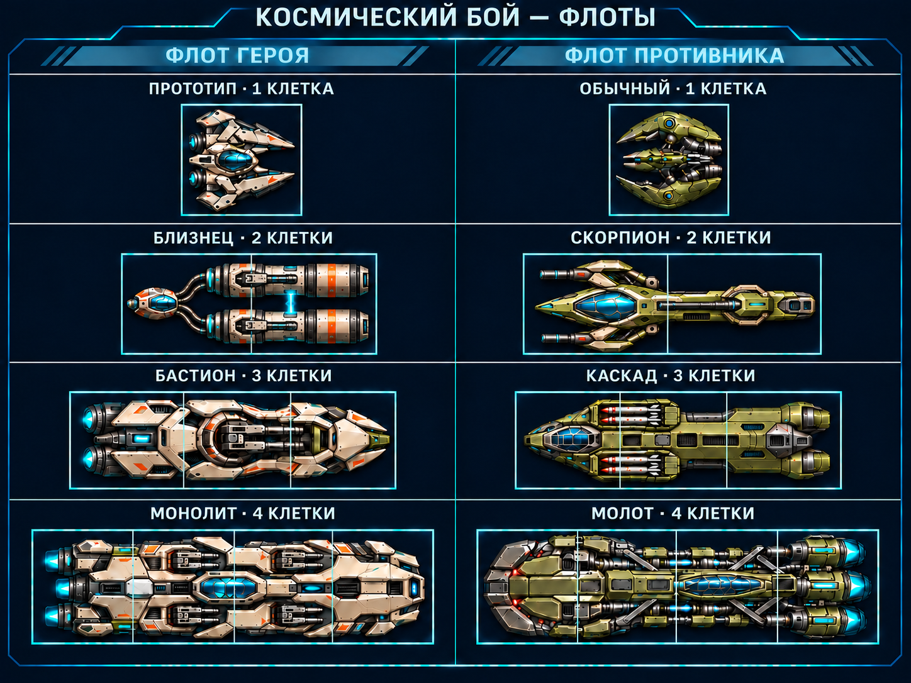
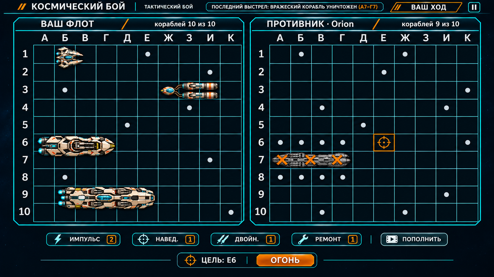
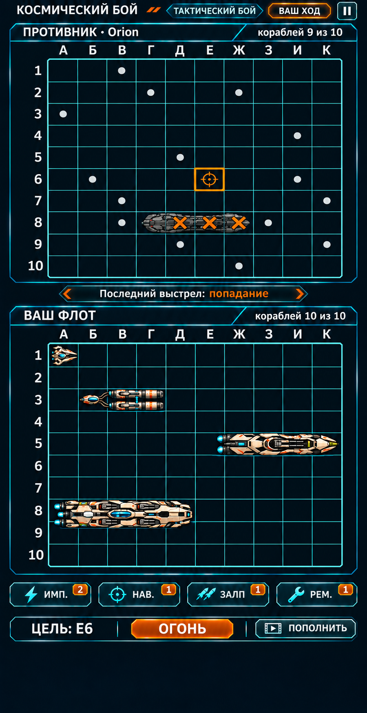

# Страж Терры: Армада

English: **Terra Defense: Armada**.

Единое ТЗ и пакет для Codex, v1. Дата: 12 ноября 2026 года.

Принятые механики и предварительные параметры разделены явно.

## 01 / Продукт и границы первого прототипа

Страж Терры: Армада / Terra Defense: Armada - одиночная пошаговая игра по правилам морского боя. Соперник выглядит как отдельный игрок, но управляется локальным ботом.

| Пункт | Зафиксированное решение |
| --- | --- |
| Режимы | Классический бой, тактический бой и все пять испытаний входят в первую версию. |
| Соперник | Случайный никнейм, скрытые уровень и характер. Выбранный профиль не меняется во время партии. |
| Стороны | Игрок выбирает один из двух флотов, бот получает противоположный. Разница флотов визуальная. |
| Поля | Два поля 10 x 10. Мышь, касания; портретная и альбомная ориентации. |
| Платформа | Браузерный прототип с последующей интеграцией Яндекс Игр. Бой и бот работают локально. |
| Сохранения | Три фиксированных слота: классический, тактический, одна попытка среди всех испытаний. |

### Название и язык интерфейса

Русский: «Страж Терры: Армада». English: Terra Defense: Armada. Это официальная локализованная пара: при смене языка меняется и название в меню, заставке и заголовке страницы. Коротко - «Армада» / Armada. Прежнее рабочее имя «Космический бой» в новом интерфейсе не использовать.

### Как читать этот пакет

Правила и последние решения по интерфейсу описаны как обязательные. Стартовые комплекты испытаний, численные настройки ботов и инженерные допущения явно отмечены как предварительные. Их можно проверять на прототипе, не меняя принятые механики.

Текст ТЗ определяет поведение; JSON повторяет константы и настройки. Если референс изображает неполный флот, прямоугольные клетки или условные счётчики, реализация следует тексту и квадратной сетке. Изображения задают внешний вид.

### Что получает разработчик

Полное ТЗ на русском, задание Codex на английском, план этапов, критерии приёмки, правила и предварительные конфигурации, три финальных референса, словарь из 500 никнеймов и задания на восемь игровых спрайтов.

Пакет является заданием на реализацию. Готового игрового кода и отдельных прозрачных спрайтов в нём пока нет. Их подготовка включена в этапы разработки.

## 02 / Поле, флот и модели кораблей

У обеих сторон одинаковые размеры кораблей, количество секций и правила повреждения. Название и рисунок не дают боевых преимуществ.

| Длина | Число | Флот героя | Флот противника |
| --- | --- | --- | --- |
| 1 клетка | 4 | Прототип | Обычный |
| 2 клетки | 3 | Близнец | Скорпион |
| 3 клетки | 2 | Бастион | Каскад |
| 4 клетки | 1 | Монолит | Молот |

Полный флот: 10 кораблей и 20 секций. Каждая секция выдерживает одно попадание. Все секции повреждены - корабль уничтожен. Победа в обычной партии наступает после уничтожения всего флота противника.

### Расстановка и координаты

Корабль занимает непрерывную горизонтальную или вертикальную полосу шириной в одну клетку. Пересечения и касания запрещены, включая диагональные. Между отдельными кораблями должен оставаться хотя бы один ряд/столбец воды.

Столбцы RU: А, Б, В, Г, Д, Е, Ж, З, И, К; EN: A-J. Строки 1-10. Внутри движка использовать числовые row/col 0-9; локализованные обозначения принадлежат интерфейсу.

### Силуэты и направление

- Прототип: бело-серая броня, оранжевые детали, голубые огни; сохранить принятый силуэт героя.
- Близнец: два массивных двигателя с верхними пушками у задних оснований; позади небольшая кабина на кабелях.
- Бастион и Монолит: бронированные корпуса с верхними орудийными башнями.
- Скорпион: передние орудия и низкая кормовая башня с одной длинной пушкой к носу; удалённые задние крылья не возвращать.
- Каскад: ракетные блоки ближе к кабине. Молот: тяжёлый ударный нос и длинный корпус.

Ракурс строго сверху, без перспективного наклона и видимых боковых граней. Корабли свободно поворачиваются вместе с занимаемой полосой; направления из Terra Defense не являются ограничением этой игры. «Шторм» - прежнее название Скорпиона, в новом интерфейсе его нет.

## 03 / Очередь, выстрел и завершение боя

Очередь - весь непрерывный период действий одной стороны до передачи управления сопернику. Попадание не начинает новую очередь.

| Действие | Что происходит с очередью |
| --- | --- |
| Обычный выстрел: попадание | Игрок продолжает очередь, выбирает новую разрешённую цель. |
| Обычный выстрел: промах | Очередь передаётся сопернику. |
| Двойной залп | Хотя бы одно попадание сохраняет очередь; два промаха передают её. |
| Импульс | Очередь сохраняется; затем доступна обычная стрельба. |
| Наведение или ремонт | Очередь завершается независимо от результата обычных выстрелов ранее в ней. |

### Одна способность на очередь

После любой применённой способности ставится abilityUsedThisTurn=true. Последующие попадания не снимают флаг. Он сбрасывается только при начале следующей очереди этой стороны после передачи управления сопернику. Выбор и отмена способности ничего не расходуют.

### Единый порядок обработки

Проверить активную сторону, статус партии, цель, лимит сценария и наличие заряда. Применить весь эффект подтверждённого действия, списать ресурс, обновить знания и статистику. Затем проверить победу; затем поражение/исчерпание лимита; затем решить, кому ходить дальше. Сохранить полученное состояние одной завершённой транзакцией.

У двойного залпа обе клетки выбираются до подтверждения. Результаты вычисляются как одно действие: обе выбранные цели допустимы по состоянию до залпа. После первого попадания нельзя заменить вторую цель. Автометки уничтоженного корабля не отменяют уже выбранный второй выстрел.

### Проверка цели

Нельзя повторно стрелять в воду, отмеченную промахом, повреждённую секцию, уничтоженный корабль или его подтверждённое пустое окружение. Исключение - секция, которую соперник отремонтировал: она снова становится допустимой целью. Неверный выбор не расходует ход, заряд или лимит.

При уничтожении последнего нужного корабля последним доступным выстрелом засчитывается победа. После завершения партии бот и ввод останавливаются. Сдача записывается отдельно от естественного поражения для начисления бесплатного буста.

Инженерное допущение для прототипа: первый ход выбирается случайно 50/50 один раз при фактическом старте боя; результат сохраняется и не перебрасывается при загрузке.

## 04 / Четыре способности

Способности доступны в тактическом бою и испытаниях. В классическом режиме панель и расход зарядов отсутствуют.

| Способность | Эффект | Очередь |
| --- | --- | --- |
| Разведывательный импульс | Выбрать квадрат 3 x 3. Получить число неповреждённых секций внутри, без их координат. Заряд расходуется после «Сканировать». | Продолжается |
| Точное наведение | Автоматически раскрыть одну случайную неповреждённую секцию противника. Урон не наносится. Подтверждение предупреждает о завершении очереди. | Завершается |
| Двойной залп | Выбрать две разные допустимые клетки и подтвердить общий залп. Каждая получает один обычный выстрел. | По попаданиям |
| Ремонтный дрон | Выбрать повреждённую секцию своего живого корабля и подтвердить восстановление одной секции. Уничтоженные корабли не восстанавливаются. | Завершается |

### Оповещения и секретность

Соперник получает сообщение о применении способности. Чужие координаты и результат импульса и наведения скрыты. Видимость выстрелов, повреждений и восстановления одинакова для человека и бота. Нельзя передавать боту закрытый результат разведки игрока.

### Уточнения для однозначной реализации

- Импульс всегда охватывает полный квадрат 3 x 3 внутри поля. У края предварительный просмотр сдвигается внутрь; итоговый квадрат показан до подтверждения.
- Число импульса - снимок на момент сканирования. Его можно хранить в истории с номером действия; он не обновляется по скрытым изменениям в реальном времени.
- Наведение выбирает среди ещё не известных целых секций; если таких нет, кнопка недоступна и заряд не тратится. Раскрытая целая секция помечается отдельно от попадания.
- После ремонта крестик снимается на обеих досках. Стрелявшая сторона помнит координату, видит восстановленную секцию и может атаковать её снова.

Эти четыре уточнения являются инженерными допущениями прототипа: они закрывают крайние случаи, не добавляя новых способностей. Кассетный удар и щит исключены из принятого набора.

## 05 / Расстановка мышью и касаниями

Единая схема управления: выбрать корабль, увидеть предварительное положение, подтвердить. Перетаскивание для первой версии не требуется.

| Шаг | Поведение |
| --- | --- |
| 1. Выбор | Панель показывает оставшееся число кораблей каждой длины. Состав испытания берётся из сценария. |
| 2. Предварительный просмотр | Касание клетки задаёт носовую секцию; полупрозрачный корабль показывает полное положение. |
| 3. Поворот | «Повернуть» переключает горизонталь/вертикаль вокруг носовой клетки. |
| 4. Подтверждение | «Разместить» фиксирует только допустимое положение. «Отмена» снимает выбор без расхода. |

Допустимое положение подсвечивается голубым. Выход за границу, пересечение или касание - красным, кнопка подтверждения недоступна. Причины: «За границей поля», «Клетки заняты», «Слишком близко к другому кораблю».

### Изменение установленного корабля

Касание выделяет корабль. Доступны «Переместить», «Повернуть», «Убрать», «Отмена». При перемещении или повороте исходная позиция сохраняется до подтверждения. В проверке нового положения выбранный корабль не считается препятствием самому себе.

### Основные действия

| Кнопка | Правило |
| --- | --- |
| Случайная расстановка | Создаёт полностью новую допустимую расстановку; при наличии кораблей сначала подтверждение замены. После неё можно править вручную. |
| Очистить поле | После подтверждения возвращает все корабли в панель. |
| Готов | Доступна только после размещения полного требуемого флота. Фактически начинает новую партию. |

До старта поле соперника скрыто. Бот формирует новую допустимую расстановку для каждой новой партии, включая реванш. Изменение ориентации экрана сохраняет корабли и текущий выбор. Выход в меню сохраняет подготовку.

Технический контракт направления: хранить noseCell и heading. Первые два положения в интерфейсе - вправо и вниз, отсчёт клеток от носа к корме. Визуал ориентируется по heading, а не по стороне героя/противника. Начальное направление - изменяемое инженерное допущение.

Стартовый тактический заряд не выдаётся на экране выбора режима или расстановки. Начисление возможно только при принятии «Готов» и успешном переходе к новой активной партии.

## 06 / Боты и честность информации

Никнейм, уровень и характер независимы. Игрок видит никнейм; технический уровень и характер в обычном интерфейсе не показываются.

| Уровень | Направление качества решений |
| --- | --- |
| Лёгкий | Больше случайности, менее точный поиск и добивание. |
| Средний | Системный поиск и добивание найденного корабля. |
| Сложный | Поиск по допустимым размещениям и более точная оценка целей. |
| Экспертный | Сильнейшая честная стратегия по доступным сведениям. |

| Характер | И / Н / З / Р |
| --- | --- |
| Агрессивный | 1 / 0 / 2 / 1 |
| Разведчик | 2 / 1 / 1 / 0 |
| Осторожный | 1 / 0 / 1 / 2 |
| Сбалансированный | 1 / 1 / 1 / 1 |

И = импульс; Н = наведение; З = двойной залп; Р = ремонт. Наборы по четыре заряда восстановлены как предварительные параметры баланса. Уровень сам по себе не увеличивает запас. Бот не смотрит рекламу и не пополняет способности в процессе партии.

### Запрет подглядывания как контракт API

Decision-функция бота получает собственный флот, историю своих выстрелов, результаты своей разведки, публичные события и состояние известных клеток. Полная скрытая расстановка игрока, результаты его разведки и будущие случайные значения в этот объект не входят.

Зная полный состав флота, бот может рассуждать о вероятных размещениях и числе оставшихся кораблей. Его догадки не становятся истинными координатами. Уровень и характер фиксируются до партии и не меняются по успехам игрока.

Предварительное распределение уровней: 30% / 40% / 25% / 5%; характеры - равновероятно. Пропорции требуют проверки. Профиль «нечестный» исключён; экспертный не получает особого доступа к полю.

Никнеймы: приложенный словарь из 500 уникальных RU/EN имён; сохранить его правила выбора, включая избегание последних 20 имён. Это авторская подборка, а не данные о популярности реальных аккаунтов.

## 07 / Постоянный запас и бесплатный старт

Тактический запас общий для профиля игрока, сохраняется между партиями и не имеет игрового потолка. Испытания используют собственные запасы.

| Источник | Изменение |
| --- | --- |
| Новый тактический бой | +1 случайный заряд, только если есть право на стартовое начисление. |
| Реклама: импульс | +2 заряда выбранного импульса. |
| Реклама: другие способности | +1 заряд выбранного наведения, залпа или ремонта. |
| Применение | -1 заряд подтверждённой способности. |
| Загрузка / поворот / пауза | Не начисляют и не возвращают заряды. |

### Однозначная схема стартового начисления

- Новый профиль: eligible=true. При фактическом старте тактической партии выдать +1, записать идентификатор начисления и установить eligible=false.
- Естественная победа или поражение в тактическом бою возвращает eligible=true. Само завершение не выдаёт второй заряд.
- Сдача или замена уже начатой тактической партии оставляет eligible=false. Следующий тактический бой начинается без начисления.
- Завершение этого следующего боя победой или поражением снова открывает право на стартовый заряд для следующей новой партии.
- Повторное «Готов», загрузка, перезагрузка страницы, смена режима и замена подготовки не дают повторного начисления.

Последнее принятое правило - начисление именно на старте при наличии права. Ранее встречавшуюся формулировку «выдавать на завершении» одновременно с ним не реализовывать.

### Реванш и общая экономика

После завершённой партии «Реванш» создаёт новую расстановку и сохраняет личность бота. Инвентарь игрока остаётся текущим. Бот получает заново свой стартовый комплект. Право игрока на стартовый заряд проверяется обычным порядком.

Глобальный запас и право на бесплатный старт хранятся отдельно от слота боя. Изменение или удаление слота не откатывает потраченные заряды. Все операции имеют уникальные идентификаторы и выполняются один раз.

Инженерные значения для чистого профиля: начальные запасы 0/0/0/0, стартовое право открыто, тип случайного заряда выбирается равновероятно. Отладочные начисления используют отдельный тестовый профиль.

## 08 / Пять испытаний

Каждая попытка имеет свой запас способностей, свой флот и признак единственного рекламного пополнения. Постоянный тактический запас не используется.

| Испытание | Цель и ограничение | Старт И/Н/З/Р |
| --- | --- | --- |
| Последний рубеж | Флот игрока: один корабль на 3, один на 2 и один на 1 клетку; бот с полным флотом. Победить. | 2 / 2 / 3 / 2 |
| Охота на флагман | Уничтожить 4-клеточный флагман за 35 действий. Полное уничтожение остальных не требуется. | 3 / 1 / 2 / 0 |
| Дефицит боеприпасов | Уничтожить флот с начальным боезапасом 45. | 3 / 2 / 1 / 1 |
| Без права на ошибку | Уничтожить флот, не исчерпав предел 35 промахов. | 3 / 3 / 1 / 1 |
| Превосходство интеллекта | Победить сильнейшего честного экспертного бота. | 6 на выбор; до 3 одного типа |

Принятые лимиты: 35 действий, 45 боеприпасов, 35 промахов. Стартовые наборы и конкретные профили ботов - предварительный баланс. В испытаниях с полным флотом использовать 4/3/2/1 кораблей по длинам 1/2/3/4.

### Рекламное продолжение

| Испытание | Одно пополнение за попытку |
| --- | --- |
| Охота на флагман | +8 действий после исчерпания 35; принято. |
| Дефицит боеприпасов | +10 боеприпасов после исчерпания; предварительная последняя поправка. |
| Без права на ошибку | Повысить предел с 35 до 45 промахов; предварительная настройка. |
| Последний рубеж / Превосходство интеллекта | В свой ход можно выбрать пополнение одной способности: импульс +2, остальные +1; предварительно. |

В трёх испытаниях с лимитом предложение продолжить появляется только при исчерпании ресурса. Можно отказаться и завершить попытку поражением. Повторное пополнение невозможно. Уничтожение своего флота заканчивает попытку без воскрешения.

«Пройдено» - победа с пополнением; «Мастерство» - победа со стартовым комплектом, без рекламного пополнения. Хранить лучшую отметку: повторное прохождение не понижает Мастерство. Правило отметок восстановлено из обсуждения; проверить формулировки на прототипе.

## 09 / Счётчики испытаний и крайние случаи

Лимиты относятся к действиям игрока. Действия бота не расходуют ограниченные ресурсы игрока.

| Подтверждённое действие | Флагман: действия | Дефицит: боезапас | Ошибки: промахи |
| --- | --- | --- | --- |
| Обычный выстрел | 1 | 1 | 0 или 1 |
| Двойной залп | 1 | 2 | 0, 1 или 2 |
| Импульс | 0 | 0 | 0 |
| Наведение | 1 | 0 | 0 |
| Ремонт | 1 | 0 | 0 |
| Выбор / отмена | 0 | 0 | 0 |

Эта матрица фиксирует восстановленные рабочие правила счёта для прототипа. Обычные дополнительные выстрелы после попадания тоже расходуют по одному действию/боеприпасу. Одна способность на очередь остаётся общим ограничением.

### Предварительная проверка достаточности

При одном оставшемся боеприпасе двойной залп недоступен: нужен полный расход 2. Обычный выстрел остаётся доступен. При нуле действий в охоте на флагман начинается состояние предложения продолжения, а не бесконечная бесплатная разведка.

### Порядок исчерпания

Полностью разрешить действие и проверить успех цели. Победа последним действием/боеприпасом засчитывается. Если цели не выполнены и ресурс достиг предела, приостановить бой и предложить единственное продолжение, если оно ещё не использовано. После отказа, повторного исчерпания или невозможности продолжить - поражение.

При достижении 35 промахов начинается исчерпание. После пополнения новое исчерпание при 45. Каждая пустая клетка залпа учитывается отдельно, даже если второй выстрел попал. Клетки, автоматически отмеченные вокруг уничтоженного корабля, промахами не считаются.

### Подготовка и сохранение попытки

У «Превосходства интеллекта» перед расстановкой выбрать ровно шесть зарядов, не больше трёх каждого типа. Выбор сохраняется. Восстановление попытки не выдаёт стартовый набор заново. Новая попытка сбрасывает набор и право пополнения, но сначала требует подтвердить замену незавершённого испытания.

Числа пополнения, профили ботов сценариев и матрица счёта вынесены в config/challenges.json с явными статусами. Старые значения 30/40 действий и 65 боеприпасов в текущие сценарии не включать.

## 10 / HUD, клетки и история противника

Оба поля видны постоянно. Компактные способности, «Пополнить» и блок «Цель / Огонь» освобождают место полям.

| Элемент | Портрет | Альбом |
| --- | --- | --- |
| Поля | Противник сверху, своё снизу | Своё слева, противник справа |
| Шапка | Режим, очередь, пауза | То же |
| Условия испытания | Компактная строка над полями | То же |
| Способности | Под своим полем | Под обоими полями |
| Подтверждение | Закреплённый низ, без перекрытия клеток | Ниже способностей |

Оба поля квадратные, каждая клетка квадратная. Поле точно вписано в свою рамку; координатные подписи находятся снаружи сетки. Учитывать системные отступы устройства. В малом окне сокращать декоративные отступы и подписи, сохраняя все клетки и доступ к действию.

| Событие | Одинаковое отображение на двух досках |
| --- | --- |
| Промах | Точка в обстрелянной клетке. |
| Попадание | Крестик на повреждённой секции. На чужом поле целый силуэт живого корабля не раскрывать. |
| Уничтожение | Вся модель серая и перечёркнутая; пустое окружение отмечено автоматически. |
| Ремонт | Крестик снимается; восстановленная секция вновь доступна для атаки. |
| Последний выстрел бота | Короткая подсветка клетки на своём поле; это история, а не будущая цель. |

Свой флот виден всегда. Чужая модель раскрывается полностью только после уничтожения; до этого видны лишь известные повреждения/раскрытые секции. У каждого поля подпись и счётчик оставшихся кораблей, например 7/10.

В очередь бота выбирать цели и способности нельзя, просмотр полей и пауза доступны. Кнопки зарядов показывают иконку, короткое название, число; после применения - «Способность в этой очереди использована». В классике панель скрыта.

Сообщения «Промах», «Попадание», «Корабль уничтожен», «Противник применил разведку» не требуют закрытия. Публичный HUD не показывает внутреннюю сложность, вероятности выбора цели или скрытую разведку бота.

## 11 / Подтверждение, меню и результат

Выбор клетки не стреляет. Окончательное действие происходит только после нажатия соответствующей кнопки подтверждения.

| Состояние | Нижняя панель |
| --- | --- |
| Обычная цель | «Цель: Е6» и «Огонь». |
| Первая цель залпа | «Цель 1: ...», «Выбрать цель», «Отмена». |
| Вторая цель залпа | Первая отмечена на поле; «Огонь» и «Отмена». |
| Импульс | Подсветка 3 x 3, «Сканировать», «Отмена». |
| Наведение | «Раскрыть секцию - завершает ход», «Применить», «Отмена». |
| Ремонт | Выделенная своя повреждённая секция, «Отремонтировать», «Отмена». |

При переключении действия прежний неподтверждённый выбор сбрасывается. Для обычной атаки своё поле не выбирается; для ремонта выбирается своё. Запрещённая цель не активирует подтверждение.

### Меню

Главное: «Продолжить» (если есть незавершённая партия), «Новая игра», «Загрузить игру», «Настройки». Продолжить открывает последнее по времени из трёх сохранений. Загрузка - три карточки режимов без названий, дополнительных слотов и удаления списка партий.

Новая игра: режим, для испытаний сценарий, выбор стороны, при необходимости выбор шести зарядов, расстановка, «Готов». Настройки: Русский / English, отдельные громкости музыки и эффектов, сокращённые анимации. Доступны из меню и паузы.

### Экран результата

Победа/поражение и причина; число выстрелов, попаданий, промахов; точность; использованные способности. В испытаниях - отметка прохождения. Наведение и импульс в точность стрельбы не включать. Двойной залп учитывает две попытки, повторное попадание после ремонта - новую попытку.

Классический/тактический: «Реванш», «Новый противник», «В главное меню». Реванш сохраняет никнейм, уровень и характер; обе стороны расставляются заново. Новый противник генерирует новый профиль. В испытаниях: «Повторить испытание», «Другие испытания», «В главное меню».

## 12 / Сохранения и целостность состояния

Финальное решение: по одному слоту на режим. Никаких названий сохранений и произвольного списка партий.

| Слот | Содержимое |
| --- | --- |
| Классический | Одна текущая подготовка или партия. |
| Тактический | Одна текущая подготовка или партия; постоянный инвентарь отдельно. |
| Испытания | Одна попытка среди всех пяти сценариев, включая выбор стартового набора. |

«Сохранить игру» в паузе и автосохранение обновляют только текущий слот. Партии других режимов сохраняются. Перед новой игрой в занятом режиме: «Заменить сохранённую партию?» - «Начать новую» / «Отмена». Отмена ничего не меняет.

Сохранять после размещения/изменения корабля, фактического старта, каждого разрешённого действия, рекламной награды, результата и обычного выхода. Нельзя полагаться только на закрытие вкладки. Сообщение «Игра сохранена» показывать после успешной записи.

### Что обязательно хранить

- Версию схемы, идентификатор партии, режим и сценарий, стадию, обе расстановки и повреждения.
- Знания каждой стороны, историю разведки и выстрелов, очередь, флаг способности в очереди, статистику.
- Профиль бота и его память/состояние генератора случайности; выбранную сторону игрока.
- Счётчики испытания, его заряды, рекламное пополнение и текущую стадию предложения продолжения.
- Отдельно: постоянные заряды, право стартового начисления, журнал уникальных операций, настройки, лучшие отметки и завершённые результаты.

### Загрузка без повторных эффектов

Загружать последнее полностью записанное состояние. Начисления, выстрелы и списания повторно не выполнять. Состояние «бот думает» может запустить вычисление заново от того же сохранённого состояния, но применить ход можно ровно один раз.

Рекомендуемая реализация: локальное хранилище с одной транзакцией на профиль + слот (например IndexedDB), версиями и миграциями. Вид хранилища - инженерный выбор. Завершённый бой убирается из «Продолжить», итог сохраняется в статистике. Скрытая информация из локального файла не передаётся decision-функции бота.

## 13 / Яндекс Игры и локальная проверка

Интеграция изолирована адаптером платформы. Отсутствие SDK на localhost не мешает запустить партию и проверить все основные правила.

### Контракт рекламы

Пользователь явно выбирает награду и просмотр. Тактическая награда: импульс +2 или другая выбранная способность +1. В испытании - только разрешённое сценарием единственное пополнение. Ошибка, недоступность и закрытие без награды ничего не начисляют.

Награда в реальной интеграции выдаётся только по onRewarded. onClose сам по себе не подтверждает просмотр. Повторный callback защищён идентификатором операции. При неуспешном запросе право пополнения испытания не расходуется.

На время рекламы поставить ввод, бота и звук на паузу. Восстановить именно прежнее состояние; закрытие рекламы не закрывает пользовательскую паузу. После реального начисления сохранить инвентарь/попытку и факт награды.

### SDK и загрузка

Подключать текущий официальный loader для среды публикации; YaGames.init() вызывается после загрузки скрипта. LoadingAPI.ready() - после готовности меню к взаимодействию. GameplayAPI и события game_api_pause/game_api_resume должны соответствовать фактической паузе/возобновлению.

На localhost предоставить явный режим разработки: сценарии успеха, отмены, ошибки и отсутствия рекламы. Тестовые награды писать только в тестовый профиль. В обычном интерфейсе достаточно понятного статуса «Реклама недоступна»; техническую диагностику показывать в отладке.

### Официальные источники

Проверены 12.11.2026; перед интеграцией повторно сверить актуальную документацию. Источники задают техническую работу SDK, а экономика игры определяется этим ТЗ.

- Connection and usage: https://yandex.com/dev/games/doc/en/sdk/sdk-about
- Rewarded video / Advertising: https://yandex.com/dev/games/doc/en/sdk/sdk-adv
- Loading and gameplay: https://yandex.com/dev/games/doc/en/sdk/sdk-game-events
- Pause/resume events: https://yandex.com/dev/games/doc/en/sdk/sdk-events

Размер наград, слоты и ядро боя не должны зависеть от присутствия глобального объекта SDK. Отдельные схемы баннеров и рекламы из Terra Defense в этот проект не переносить.

## 14 / Архитектура и порядок разработки

Рекомендуется TypeScript и браузерный интерфейс. Если в репозитории уже есть рабочий стек, сохранить его; конкретные библиотеки и версии выбираются при реализации.

| Слой | Ответственность |
| --- | --- |
| Ядро правил | Валидация расстановки/целей, действия, очередь, урон, ремонт, победа и лимиты. Чистые функции без DOM и SDK. |
| Знания и бот | Отдельные снимки видимой информации. Бот выбирает команды, но не изменяет состояние напрямую. |
| Приложение | Сценарии меню/подготовки/боя/паузы/результата, подтверждения и сохранения. |
| Платформа | Локальный и Yandex-адаптер, реклама и пауза. |
| Представление | Поля, спрайты, HUD, локализация и ввод. |

### Этапы со сквозным рабочим результатом

| Этап | Готовый результат |
| --- | --- |
| 1. Классическая партия | Обе стороны флота, расстановка, честный бот, очередь, уничтожение, результат и реванш. |
| 2. Сохранения | Три фиксированных слота, подготовка и бой, подтверждение замены, настройки. |
| 3. Тактика | Все четыре способности, одна на очередь, постоянные заряды, антидублирование стартового буста. |
| 4. Испытания | Все пять сценариев, счётчики, выбор шести зарядов, отдельная экономика и отметки. |
| 5. Платформа и оформление | Рекламный адаптер, SDK, финальные спрайты, компактный HUD, RU/EN, Firefox и мобильные размеры. |

Не откладывать испытания из первого релиза: этапы задают порядок, а не сокращение состава. Для промежуточных проверок достаточно браузерной сборки. Финальная приёмка охватывает три режима.

Перед изменениями Codex читает инструкции репозитория и определяет существующие команды запуска, проверки и сборки. Если исходного проекта нет, создаёт минимальную рабочую структуру с документированным запуском. Собранный пакет содержит задания, а не зависимости или фиктивную готовую сборку.

## 15 / Приёмка и проверка баланса

Тесты должны проверять правила и важные переходы. Полный список сценариев с ожидаемым результатом находится в docs/ACCEPTANCE_RU.md.

| Блок | Что обязательно доказать |
| --- | --- |
| Расстановка | 100% допустимых случайных флотов; запрет касаний по диагонали; перемещение не пересекается само с собой; отмена сохраняет исходную позицию. |
| Очередь | Попадание сохраняет очередь; две ошибки залпа передают её; способность не обновляется после попадания; ремонт/наведение завершают. |
| Информация | Чужая модель не раскрыта до уничтожения; бот получает только доступные ему сведения; изменения скрытого поля не меняют решение при равных знаниях. |
| Экономика | Ни загрузка, ни повторный callback не дублируют награду; после сдачи следующий бой без стартового начисления; естественное завершение открывает право. |
| Испытания | Правильный расход лимитов, победа последним ресурсом, ровно одно пополнение, отсутствие связи с постоянным инвентарём. |
| Сохранения | Один слот на режим; запись одного не меняет другие; восстановление очереди, расстановки и заряда без повторения эффектов. |
| Интерфейс | Firefox, мышь/касания, обе ориентации, квадратные клетки, все доступные действия видны и не перекрывают поле. |

### Предварительная матрица размеров

Проверить как минимум 360 x 800, 390 x 844, 412 x 915, 768 x 1024, 844 x 390, 1366 x 768 и 1920 x 1080. Это тестовые размеры CSS-окна, а не фиксированное разрешение игры. При повороте сохраняются подготовка, текущая очередь и предварительный выбор.

### Баланс на работающей игре

Собирать число действий, длительность, точность, использование способностей, победы и причины поражений по режиму/сценарию и профилю бота. Сравнивать ботов на одинаковых наборах начальных условий. Числа и выводы добавлять после запусков, не выдавать план проверок за готовый отчёт.

Изменение предварительных коэффициентов отражать в конфиге и журнале. Принятые лимиты и механику способностей не менять молча под результаты автопрогонов. Пакет v1 проверен как комплект документов и данных; игровой баланс ещё не измерялся.

## 16 / Предварительные решения и приоритеты

Параметры ниже дают Codex возможность собрать однозначный прототип. Их статус виден в файлах конфигурации; они не выданы за окончательное согласование.

| Параметр | Рабочее значение / статус |
| --- | --- |
| Первый ход | 50/50 при старте; инженерное допущение. |
| Чистый тактический профиль | 0/0/0/0 и право +1 на первый старт; инженерное допущение. |
| Случайный стартовый заряд | Равные веса четырёх типов; инженерное допущение. |
| Доли сложностей ботов | 30/40/25/5%; предварительный баланс. |
| Характеры и наборы бота | Равные веса; наборы 1/0/2/1, 2/1/1/0, 1/0/1/2, 1/1/1/1; предварительно. |
| Наборы испытаний | Из таблицы на странице 8; предварительно. |
| Пополнение испытаний | Флагман +8 принято; дефицит +10 и ошибки до 45 предварительно. |
| Импульс/наведение/ремонт | Полный 3 x 3, снимок результата, неизвестная целая секция, публичное восстановление; инженерные уточнения. |
| Марки прохождения | Победа с пополнением / без него; восстановленное рабочее правило. |
| Отдельные спрайты | 8 прозрачных изображений ещё подготовить и проверить в сетке; финальный общий лист приложен. |

### Приоритет в спорной ситуации

Последнее прямое решение пользователя выше раннего варианта. Для этого пакета: один слот на режим выше многослотовой схемы; Скорпион выше Шторма; 35 действий и 45 боеприпасов выше старых лимитов; честный эксперт выше отменённого нечестного бота.

Условия, которых нет в этом пакете и репозитории, не объявлять принятыми. Неблокирующие детали оформлять как допущения в журнале реализации. Если найдено реальное противоречие, сохранить текст обеих версий и вынести только конкретное решение.

Перед первой проверкой игроком вывести в отчёте: какие этапы завершены, какие реальные команды и проверки прошли, где остаются временные изображения/настройки. Пользовательский интерфейс при этом показывает только понятные игровые понятия.

## Приложения: принятые визуальные референсы

### Финальный общий лист восьми кораблей

Исходный файл: Космический бой — флот из восьми кораблей(1).png. Это визуальный референс, не набор готовых спрайтов.

### Принятый компактный HUD: альбомная ориентация

Исходный файл: Большие поля, компактный HUD морского боя.png. Это визуальный референс, не набор готовых спрайтов.

### Принятый компактный HUD: портретная ориентация

Исходный файл: Портретный интерфейс морского боя.png. Это визуальный референс, не набор готовых спрайтов.
